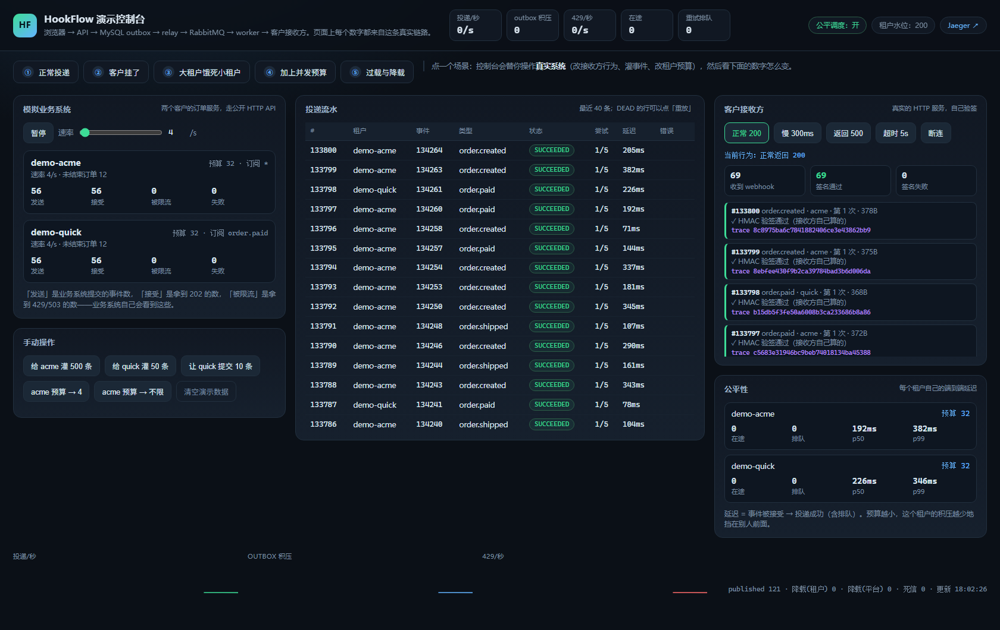

# HookFlow

**多租户 Webhook / 事件投递平台：接收事件，签名后异步投递到客户回调地址，失败自动退避重试，全程可追踪、可重放。**

[](https://github.com/shifang37/hookflow/actions/workflows/ci.yml)
[](https://github.com/shifang37/hookflow/actions/workflows/docker.yml)
[](https://github.com/shifang37/hookflow/actions/workflows/helm.yml)
[](https://github.com/shifang37/hookflow/actions/workflows/sdk.yml)


---

## 一句话解释它解决什么问题

业务系统（比如订单服务）要把 `order.paid` 这类事件推给客户的服务器。客户的服务随时可能返回 500、超时、或者干脆连不上。**如果推送逻辑写在订单服务里，那么：网络抖动会拖慢下单接口，投递失败无人知道，失败之后没有重试，重试又可能把同一个事件推两次。**

HookFlow 把这件事从业务系统里拆出来，变成一个**独立的、语义明确的投递平台**：业务系统只负责"提交事件"，剩下的签名、排队、重试、死信、追踪、重放都由平台承担。

## 它不是

- ❌ 不是 exactly-once 系统。**它是 at-least-once**，并且这里不打算掩饰这一点（见 [ADR-0002](docs/adr/0002-at-least-once-not-exactly-once.md)）
- ❌ 不是微服务集群。它是模块化单体，按运行角色（api / relay / worker）启动（见 [ADR-0004](docs/adr/0004-modular-monolith-with-roles.md)）
- ❌ 不是 Svix / Hookdeck 的替代品，没有生产级 SLA
- ✅ **但 QPS 数字现在是实测的**，带机器规格、失败率、原始输出和测量方法的缺陷记录（见 [docs/performance.md](docs/performance.md)）

---

## 能扛多少（实测，v0.4）

这台机器（i5-14600K 14C/20T、31.7GB、MySQL 8.4 in Docker、`all` profile 单 JVM、payload 2KB、开环压测）。
**"入口能接多少"和"平台能送多少"是两个数字——所以分开写。** B7/B8 之后它们接近了（450 入口能被完整送达），
但 900 入口仍然只能送出 ~400/s，差距没有消失。

| 入口形态 | 到达率 | 接受率 | 开环 p50 / p99 | **平台持续投递（端到端）** |
|---|---:|---:|---|---:|
| 单条 `POST /v1/events` | 300 events/s | 100% | 33 / 111 ms | — |
| 批量 20 条 | 450 events/s | 100% | 67 / **160 ms** | 41/s → **455–470/s**（outbox 不涨：worker 32 + relay batch 100） |
| 批量 20 条 | 900 events/s | 100% | 79 / **298 ms** | **382–421/s**（worker 先满；relay 能发 449–731/s） |

**结论：B7/B8 之后，450 events/s 可以被完整送到客户（455–470/s，outbox 始终只有几十到 ~200 行、观察期归零）；
900 时 worker 先满（382–421/s），relay 这时还有余量（batch 100 发 449/s、batch 200 发 731/s）。
worker 的杠杆是**并发**（32 并发 + 池 32，不是提交次数），relay 的杠杆是 **batch-size**（50 → 100），
而把 claim 与 markPublished 合并**不值得做**：900 下交付不是 relay 限制的（[performance.md §22.4](docs/performance.md#224-claim--markpublished-要不要合并不合并)）。**

> 450 那行的 p99 160 ms 比 B5 时的 86.6 ms 高——32 并发下 ingest 与 worker 更频繁地抢同一批 DB 连接。
> 这是吞吐换来的（§21.2 有对照）；它仍在 §14.3 记的本机 p99 散布之内，所以**不能**声称"32 并发没有让入口变慢"。

> 三步各有证据：B4 把 relay 的「逐条 confirm + 单行 UPDATE」批量化（41 → 400–466/s，[§16](docs/performance.md)、
> [ADR-0014](docs/adr/0014-batched-relay-publish.md)）；B5 把 worker 并发 8→16 并去掉 2→8 的爬坡
> （158 → 283/s，[§18](docs/performance.md)）；B7/B8 把并发再翻到 32、池 32，并把 relay 的 batch 提到 100
> （264 → 455–470/s，[§21](docs/performance.md#21-worker-抬到-relay-之上32-并发--池-32v04-b7)、[§22](docs/performance.md#22-relay-batch-size-50--100--200每批的固定成本v04-b8)）。
> prefetch 那一格也量了：**没用**；连接池在 32 并发下会到 2–5 个 pending，所以池跟着改成 32。

三个最能说明问题的数字：

1. **闭环压测会把 p99 低估 11.9 倍**（同一批请求：开环 905ms vs 闭环 229ms）。所以本项目的压测器输出两个视角。
2. **一个租户的洪水对小租户 p99 的影响：4 584ms → 190ms**，只因为给洪水租户设了并发预算（`max_in_flight`）。
3. **过载 3 倍时，水位线决定是降级还是雪崩**：水位 10 000 → p99 2.7s、积压 10 258 行；水位 200 → p99 84ms、92% 请求 2.3ms 内被 429、积压 15 秒归零。

> **v0.3 的"本机稳定 300 events/s、瓶颈是 DB 提交"这句话已经被推翻**：那 300/s 是"入口在接受"，30 秒窗口里积压
> 还没越过水位线；B0 的重测（[performance.md §15](docs/performance.md)）给出真实持续吞吐 **41 events/s**，
> 瓶颈是 relay 的"每行一次 confirm + 一次单行 UPDATE 提交"。B4 把它批量化后是 400–466/s，见
> [§16](docs/performance.md) 与 [ADR-0014](docs/adr/0014-batched-relay-publish.md)。


完整报告（含 GC 日志、JFR 证据、fsync A/B、**以及测量方法本身犯过的三个错误**）：[docs/performance.md](docs/performance.md)。容量模型与"扩容先加谁"：[docs/capacity.md](docs/capacity.md)。

**v0.4 批量提交**（`POST /v1/events/batch`，20 条/请求，同一台机器、同一天、改造前后各两次对照）：同一到达率 450 events/s 下，单条路径开环 p50 / p99 = **1.10 s / 2.31 s**，批量 = **42.7 ms / 69.5 ms**；批量到 900 events/s 仍 100% 接受（p99 1.39 s）。**这是入口指标，不是投递指标**——下游排空未变，单条路径的 p99 对照也**未测出差异**（散布 64–289 ms）。数字、方法与"没证明什么"：[performance.md §14](docs/performance.md)。
下游那一半后来在 [§15](docs/performance.md) 补测（B0），并在 [§16](docs/performance.md) 修掉（B4，relay 41 → 400–466/s）。

> README 里出现的每一个数字都对应 `docs/perf/` 下的一份原始输出（v0.3 在 `2026-10-22/`，v0.4 批量在 `2026-10-23-batch/`，下游再基线在 `2026-10-23-downstream/`，批量发布之后在 `2026-10-23-relay-batch/`，worker 并发在 `2026-10-23-worker/`，32 并发在 `2026-10-23-worker32/`，relay batch 曲线在 `2026-10-23-relay-batch-size/`）。没测的（wrk2 交叉验证、async-profiler 火焰图、4C8G 真机、32 并发对慢接收方）在报告里标了「未测」，不在这里猜。

---

## 演示控制台：点一下就能看到它是怎么工作的



```bash
docker compose up -d
./mvnw spring-boot:run        # → http://localhost:8080/demo/
```

页面里有一个**模拟业务系统**（两个租户的订单服务，跑真实的订单生命周期，通过带 API Key 的公开
HTTP API 提交事件）和一个**假客户接收方**（真 HTTP、自己验 HMAC、可以被切成返回 500 / 慢 5 秒 / 断连）。
按钮只做「改配置、灌事件」，流量走的是真实链路：API → MySQL outbox → relay → RabbitMQ → worker → 接收方。

五个场景，每个对应 v0.3 的一条主张：

| 场景 | 你会看到什么 |
|---|---|
| ① 正常投递 | 每条约 100–300ms 成功，接收方验签 ✓，每条 webhook 带同一 trace id |
| ② 客户挂了 | `RETRY_WAIT` → 尝试 5/5 按 `base×2ⁿ` 退避 → `DEAD` → 点「重放」用新的一次尝试救回来 |
| ③ 大租户饿死小租户 | 预算「不限」+ 300 条洪水，受害者租户 p99 被拖到秒级（v0.2 行为） |
| ④ 加上并发预算 | 只把洪水租户的预算改成 4，受害者 p99 掉到百毫秒级，而积压总量不变 |
| ⑤ 过载与降载 | 到达率拉到 200/s：429 上升、积压顶在水位线、p99 不爆炸；降速后积压自己排空 |

细节（含**为什么它可以没有鉴权**、以及**它没有证明什么**）：[docs/demo.md](docs/demo.md)。

---

## 运营控制台：事件流、投递、租户、监控

`/demo/` 是单机演示，`frontend/` 是给人日常用的那个界面：React 18 + TypeScript + Vite，
Ant Design + React Query + Zustand + Recharts。五个页面都读前面那组接口：

| 页面 | 数据来源 | 凭证 |
|---|---|---|
| 事件流（2 秒轮询） | `GET /v1/events` | 租户 API Key |
| 投递（筛选 + 重放死信） | `GET /v1/deliveries` + `POST …/replay` | 租户 API Key |
| Endpoints（新建 / 暂停 / 恢复） | `/v1/endpoints` | 租户 API Key（写操作要 `endpoint:write`） |
| 租户（创建 / 统计 / 改策略 / Key 轮换） | `/v1/admin/tenants*`、`/tenants/{id}/keys` | Bootstrap Token |
| 系统监控（吞吐折线 + 耗时分布 + 百分位） | `/v1/admin/overview`、`/metrics/timeseries`、`/metrics/latency` | Bootstrap Token |

```bash
./mvnw spring-boot:run          # 终端 1
cd frontend && npm install && npm run dev   # 终端 2 → http://localhost:5173
```

首次打开会提示填凭证（右上角「凭证」）：租户 Key 用建租户响应里的 `apiKey`，运营令牌就是
`hookflow.admin.bootstrap-token`。开发服务器把 `/v1` 代理到 8080，所以没有 base URL、也不用开 CORS。

生产构建 `npm run build:backend` 会把产物复制到 `src/main/resources/static/ui/`，后端从 `/ui/`
提供服务（客户端路由由 `UiForwardController` 兜到 `index.html`，刷新不会 404）。
构建产物不入库，也不接进 `mvn package` —— 理由和取舍写在 [frontend/README.md](frontend/README.md)。

---

## 60 秒跑通

```bash
# 1. 起依赖（MySQL 8.4 + Redis + RabbitMQ）
docker compose up -d
#    若本机 3306 已被占用：DB_PUBLISH_PORT=13306 DB_PORT=13306 docker compose up -d

# 2. 起服务
./mvnw spring-boot:run

# 3. 起一个假接收方（另一个终端）
java -cp target/classes dev.hookflow.tools.MockReceiver 9099
# → listening on http://localhost:9099/hook
```

```bash
# 4. 开租户，拿到 API Key（响应里只会出现这一次）
curl -s -X POST localhost:8080/v1/admin/tenants \
  -H 'X-Bootstrap-Token: hookflow-dev-bootstrap-token' \
  -H 'Content-Type: application/json' \
  -d '{"name":"demo","rateLimit":100}'
# {"tenantId":1,"name":"demo","apiKey":"hk_aB3dE7fG_...","keyPrefix":"aB3dE7fG"}
```

```bash
# 5. 建一个回调 endpoint，拿到签名密钥（同样只出现一次）
curl -s -X POST localhost:8080/v1/endpoints \
  -H "Authorization: Bearer $TOKEN" -H 'Content-Type: application/json' \
  -d '{"url":"http://127.0.0.1:9099/hook","subscribedTypes":"order.paid"}'

# 6. 提交一个事件
curl -s -X POST localhost:8080/v1/events \
  -H "Authorization: Bearer $TOKEN" \
  -H 'Idempotency-Key: order-1001-paid' \
  -H 'Content-Type: application/json' \
  -d '{"eventType":"order.paid","payload":{"orderId":1001,"amount":99.00}}'
# 202 {"eventId":1,"deliveryCount":1,"idempotentReplay":false}
```

```bash
# 7. 看结果：接收方收到了什么
curl -s localhost:9099/received

# 8. 看投递状态与每次尝试
curl -s "localhost:8080/v1/deliveries/1" -H "Authorization: Bearer $TOKEN"
# {"delivery":{"status":"SUCCEEDED","attemptCount":1,"lastStatusCode":200},
#  "attempts":[{"attemptNo":1,"status":"SUCCEEDED","statusCode":200,"durationMs":7}]}
```

**现在故意让它失败一次**：让接收方返回 500，观察重试阶梯。

```bash
# 让 MockReceiver 之后都返回 500（不需要重启）
# 触发一次新事件，然后轮询 delivery 状态
curl -s "localhost:8080/v1/deliveries?status=RETRY_WAIT" -H "Authorization: Bearer $TOKEN"
# nextAttemptAt 会按 指数退避 + 抖动 递增；attempt 用完后状态变成 DEAD

# 修好之后手动重放
curl -s -X POST localhost:8080/v1/deliveries/2/replay -H "Authorization: Bearer $TOKEN"
```

> MockReceiver 的行为由 query 参数控制：`/hook?status=500`、`/hook?delay=3000`（触发读超时）。

> **这套流程已在 Windows 11 + Docker Desktop 上实测通过**，包括接收方独立验签（`signature_valid=true`）
> 与幂等重放（同一 `Idempotency-Key` 返回同一 `eventId`）。
> 首次运行需要下载 MySQL / Redis / RabbitMQ 镜像，约 240 MB + 180 MB，视网络 1–10 分钟。

---

## 架构

```
                       ┌──────────────────────────────┐
  业务系统 ──POST──▶   │  api        (Spring Boot)     │
                       │  · API Key 鉴权（只存 hash）   │
                       │  · Redis 租户限流 (Lua)        │
                       │  · MySQL 幂等去重              │
                       └───────────────┬──────────────┘
                                       │  一个事务内写入
                                       ▼
                    ┌────────────────────────────────────────┐
                    │  MySQL 8.4 — 唯一权威状态               │
                    │  event / delivery / delivery_attempt    │
                    │  outbox  ← 待发布的工作消息             │
                    └───────────────┬────────────────────────┘
                                    │ FOR UPDATE SKIP LOCKED
                                    ▼
                       ┌──────────────────────────┐
                       │  relay                    │
                       │  领取 → publish → confirm │
                       │  → 标记 PUBLISHED         │
                       └────────────┬─────────────┘
                                    │ publisher confirm
                                    ▼
                       ┌──────────────────────────┐
                       │  RabbitMQ (quorum queue)  │
                       └────────────┬─────────────┘
                                    │ manual ack
                                    ▼
                       ┌──────────────────────────────────┐
                       │  worker                           │
                       │  claim(CAS+lease) → 签名 → HTTP    │
                       │  → attempt 落库 → 收敛状态         │
                       └────────────┬─────────────────────┘
                                    ▼
                          客户 Webhook 接收方
```

三个角色**同一份代码、同一个镜像**，用 Spring profile 切换：`--spring.profiles.active=api|relay|worker`（不填则 `all`，本地演示用）。

为什么这样切：[ADR-0004](docs/adr/0004-modular-monolith-with-roles.md)。

---

## 投递语义（这是项目的核心，请重点看）

完整说明见 **[docs/delivery-semantics.md](docs/delivery-semantics.md)**。

### 保证什么

| 保证 | 怎么做到的 | 怎么验证的 |
|---|---|---|
| 事件被接受后不会丢 | 事件与 outbox 在同一 MySQL 事务内落库 | `EventIngestIT`、relay 崩溃演练 |
| 同一幂等键只产生一个事件 | `UNIQUE (tenant_id, idempotency_key)` | `EventIngestIT` 20 线程并发测试 |
| 每个 (event, endpoint) 只有一条 delivery | `UNIQUE (event_id, endpoint_id)` | 同上 |
| 同一 delivery 不会被两个 worker 同时投递 | `attempt_count` CAS + `lease_token` 护栏 | `claimIsExclusive` |
| worker 崩溃后投递会被接手 | lease 过期 → 回收 → 重新入队 | `expiredLeaseIsReclaimed` |
| 4xx 不会无意义重试 | 错误分类（见下表） | `clientErrorsAreNotRetried` |
| 接收方能验证请求确实来自本平台 | HMAC-SHA256 + 时间戳 + 绑定 event/delivery id | `successfulDelivery`（接收方自行验签） |

### 明确不保证什么

| 不保证 | 原因 |
|---|---|
| **exactly-once** | 接收方可能已处理但本平台没收到响应。任何承诺端到端 exactly-once 的说法都是错的 |
| **顺序** | 多个 worker 并行消费，同一 endpoint 的 delivery 不保证按提交顺序到达 |
| **投递时间上限** | 指数退避 + 抖动，最长间隔受 `max-delay-ms` 约束，但整体耗时不承诺 |
| **接收方幂等** | 这是接收方的责任。平台提供稳定的 `event_id` 让它去重 |

### 失败分类（决定重试还是一次性判死）

| 接收方行为 | 分类 | 是否重试 |
|---|---|---|
| 2xx | 成功 | — |
| 5xx | `SERVER_5XX` | ✅ 重试 |
| 408 / 429 | `RETRYABLE_4XX` | ✅ 重试 |
| 连接失败 / DNS 失败 | `CONNECT_ERROR` | ✅ 重试 |
| 读超时（> `read-timeout-ms`） | `TIMEOUT` | ✅ 重试 |
| 其他 4xx | `CLIENT_4XX` | ❌ 直接 `DEAD` |
| 3xx（不跟随） | `CLIENT_3XX` | ❌ 直接 `DEAD` |

### 重试阶梯

`delay = min(base × 2^(n-1), max)`，然后 jitter 到 `[delay/2, delay)`。

默认 `base = 5s`、`max = 1h`、`maxAttempts = 8`，实际间隔约为
`2.5–5s → 5–10s → 10–20s → 20–40s → 40–80s → 80–160s → 160–320s → 320–640s`。

**为什么要抖动**：不加抖动，一次 broker 故障会让所有等待中的 delivery 在同一毫秒重试，恢复后的接收方会被同步的请求洪峰打死。

---

## 故障窗口：崩溃了会怎样

这张表是这个项目最值得看的部分。每一行都说明"在哪个位置崩溃"以及"恢复后会发生什么"。

| 崩溃位置 | 数据是否丢 | 是否会重复 | 谁负责收敛 |
|---|---|---|---|
| 写 `event`/`delivery`/`outbox` 事务中 | 不丢（事务回滚，调用方收到错误） | — | 调用方重试 |
| relay 领取后、publish 前 | 不丢（outbox 仍是 PUBLISHING） | 可能重复 | `OutboxSweeper`（60s 后重置为 NEW） |
| **broker 已确认、outbox 未标记** | 不丢 | **会重复** | `OutboxSweeper` 重新发布 → 这正是 at-least-once 的来源 |
| worker claim 后、HTTP 前 | 不丢 | — | lease 过期 → `DeliveryRecovery` 回收 |
| **HTTP 已发出、响应前崩溃** | 不丢 | **会重复**（对方可能已处理） | lease 过期回收；接收方按 `event_id` 去重 |
| worker 写完 attempt、未更新 delivery | 不丢 | — | lease 回收，attempt 标记 `ABANDONED` |
| broker 丢消息 | 不丢 | — | `requeueStuckPending`：PENDING 超过 60s 自动重新入队 |

**核心结论：MySQL 是唯一权威状态，broker 里没有"必须存在"的信息。** 所以丢一条 MQ 消息不等于丢一次投递——这是刻意设计的。

---

## 接口

完整说明见 [docs/api.md](docs/api.md)，在线文档 `http://localhost:8080/docs`。

| 方法 | 路径 | 说明 |
|---|---|---|
| `POST` | `/v1/admin/tenants` | 开租户并发首个 API Key（需 `X-Bootstrap-Token`） |
| `POST` | `/v1/admin/tenants/{id}/keys` | 追加 API Key |
| `POST` | `/v1/endpoints` | 建回调地址，返回签名密钥（仅一次） |
| `GET` | `/v1/endpoints` | 列出 endpoint |
| `POST` | `/v1/endpoints/{id}/pause` | 暂停（并取消排队中的投递） |
| `POST` | `/v1/endpoints/{id}/resume` | 恢复（已取消的不复活） |
| `POST` | `/v1/events` | 提交事件，需 `Idempotency-Key` |
| `POST` | `/v1/events/batch` | 一次提交最多 500 条事件（一个事务，按条返回 `replay`） |
| `GET` | `/v1/events/{id}` | 查事件 |
| `GET` | `/v1/deliveries` | 查投递（按 event / status 过滤） |
| `GET` | `/v1/deliveries/{id}` | 查投递 + 全部 attempt |
| `POST` | `/v1/deliveries/{id}/replay` | 重放 `DEAD` 投递 |
| `GET` | `/actuator/health` | 健康检查（含 readiness/liveness） |
| `GET` | `/actuator/prometheus` | 指标 |

统一错误体：

```json
{"code": 40901, "error": "IDEMPOTENCY_KEY_REUSED", "message": "...", "requestId": "...", "timestamp": "..."}
```

`requestId` 同时出现在响应头 `X-Request-Id` 和日志 MDC 里，可以直接拿它去搜日志。

---

## 测试：每个测试在证明什么

```bash
./mvnw test      # 164 个单元测试（含 16 个 jqwik 属性测试、8 个公平调度、5 个降载），秒级，不需要 Docker
./mvnw verify    # 164 单元 + 69 集成 = 233 个测试，起真实 MySQL 8.4 与 RabbitMQ 4（需 Docker，数分钟）
```

| 测试 | 证明的命题 |
|---|---|
| `BackoffTest` / `BackoffPropertyTest` | 退避指数增长、被上限截断、抖动恒落在 `[cap/2, cap)`；对 200 组随机 `(base, max, attempt)` 成立 |
| `SigningPropertyTest` | 任意 secret/id/时间戳/body 都能自验签；任一项变化则验签失败；签名长度与十六进制格式恒定 |
| `SubscriptionPropertyTest` | 订阅匹配是精确匹配；通配符覆盖全部；空白与重复声明不改变语义 |
| `EgressGuardTest` | 回环/私有/链路本地/CGNAT/保留段全部拒绝（对 IPv4 全空间做属性测试）；白名单与演示模式可覆盖 |
| `SecretCipherTest` | 每次加密用新 IV；篡改密文或换主密钥则解密失败 |
| `DeliveryStatusTest` | 状态机语义与文档一致 |
| `WeightedRoundRobinTest` | 3:1 在 40 次内精确 30/10；**轻租户的最大间隔受权重比约束，不随队列长度增长** |
| `AdmissionControlTest` | 预算边界、endpoint 上限只挡自己、**本地计数在刷新前就已生效**（否则一次会发出整批） |
| `BacklogGateTest` | 平台级 503 / 租户级 429 分开；`Retry-After`；计数每区间只算一次 |
| `DeliveryMessageTest` | `traceparent` JSON 往返；**v0.2 的旧 outbox 行仍能解析**（否则升级时最后几行会进 DLQ） |
| `EndpointPauseRetryTest` | 死锁牺牲者会被重试（见 failures/0007），审计只写一次，且走的是公共重试组件（指标 +1） |
| `RetryOnLockConflictTest` | 只重试锁冲突（含锁等待超时）；3 次后原样抛出；`hookflow_db_lock_conflict_total` 在 Prometheus 文本格式里可见 |
| `DemoResetRetryTest` | 演示控制台的重置也走同一个组件；非锁异常不会被组件吞掉（外层多轮循环仍然负责 FK 竞争） |
| `DeliveryAttemptRetentionTest` | `attempt-days=0` 完全不发 SQL；批次循环有界；**保留期 ≥ lease TTL + 1 天**这条前提直接读 `application.yml` 验证 |
| `TenantRateLimiterTest` | 限流按**事件数**计：一批 20 条要 20 个配额，超了整批 429 |
| `EventIngestIT` | 20 并发同幂等键 → 1 个事件；扇出过滤；claim 互斥；lease 回收；outbox 唯一键允许下一轮 |
| `BatchIngestIT` | 真实 HTTP：20 条夹 3 条已存在的幂等键 → 20 个正确 `eventId`、事件与投递都不重复；整批重放返回 200 且 id 不变；批内重复键 → 一个事件；超过 500 条整批 400 |
| `AttemptRetentionIT` | 真实 MySQL：30 天前的 attempt 被清理、`IN_PROGRESS` 的一条无论多老都保留、`V3` 索引存在、清理后 settle 仍能命中行 |
| `EndToEndDeliveryIT` | 真实链路 2xx/5xx/4xx/replay/pause 五种结局 |
| `ReceiverFaultIT` | 慢接收方 → `TIMEOUT`；连接被拒 → `CONNECT_ERROR`；故障消失后**同一个** delivery 自动成功 |
| `BrokerOutageIT` | broker 冻结期间事件仍被接受、不产生任何 attempt、工作停在 outbox；恢复后自动追平且只尝试一次 |
| `OutboxCrashWindowIT` | 「确认后崩溃」窗口：sweeper 重新武装 → 消息重复 → attempt 护栏吸收，接收方只看到一次尝试 |
| `FairnessIT` | 同一场景跑两遍，只改洪水租户的并发预算：受害租户 p99 **4 584ms → 190ms** |
| `BackpressureIT` | 真实 HTTP：积压超水位 → `429` + `Retry-After`；恢复后已接受的事件全部投递成功、租户被重新放行 |
| `TracingIT` | 接收方收到的 `traceparent` 与 API 返回的 `X-HookFlow-Trace-Id` 是**同一个 trace**（5 跳一条链路） |
| `DemoConsoleIT`（5） | 演示控制台不是动画：模拟业务系统的流量真的产生投递、接收方真的验签、5xx 真的走到死信并能重放、预算按钮真的改库 |

**为什么坚持用容器而不是 H2**：`FOR UPDATE SKIP LOCKED`、JSON 列、CHECK 约束、quorum queue 这些行为在替代品里都不一样。更重要的是——下面三个真实缺陷只有"真实 MySQL + 真实 RabbitMQ + 与数据库不同时区的 JVM"才能暴露，H2 同进程跑会全部掩盖：

| 缺陷 | 一句话 | 文档 |
|---|---|---|
| 0001 | 并发幂等时输掉竞争的一方返回 500（REPEATABLE READ 快照看不到赢家） | [docs/failures/0001](docs/failures/0001-idempotent-race-snapshot.md) |
| 0002 | 重试永不触发（JVM 是 UTC+8，MySQL 是 UTC，两个时钟被拿来比较） | [docs/failures/0002](docs/failures/0002-two-clocks.md) |
| 0003 | broker 停机时 outbox 行卡在 PUBLISHING（异常类型没被接住） | [docs/failures/0003](docs/failures/0003-publisher-send-outside-try.md) |
| 0007 | 批量取消（暂停端点）与逐行认领相互死锁——**只有把并发量提到 1 500 行才会出现** | [docs/failures/0007](docs/failures/0007-cancel-vs-claim-deadlock.md) |

这四个文档比任何功能列表都更能说明这个项目被真正跑过。

---

## CI/CD：每次 push 自动跑什么

| workflow | 触发 | 做什么 | 状态 |
|---|---|---|---|
| [ci.yml](.github/workflows/ci.yml) | push `master`/`main`、所有 PR | 164 个单测、带 JaCoCo 的单测（`-Pcoverage`）、`verify`（69 个 Testcontainers IT）、package；前端 typecheck / lint / test / build | run #15：后端 build 成功（164 单测 + JaCoCo + 69 IT），Codecov 步骤**按设计跳过**（没有 token）；前端 `test:coverage` 有 3 个用例在 2 核 runner 上超过 30s（runs 13–15），已把 `testTimeout` 提到 60s，修复后的运行见 Actions |
| [docker.yml](.github/workflows/docker.yml) | push `master`、tag `v*` | 先 `npm ci && npm run build:backend`（Dockerfile 不跑 npm），再用 buildx 推 `ghcr.io/shifang37/hookflow`：`sha-<短>`、master 的 `latest`、tag 名 | **已在 run #1 验证**：前端构建、buildx 构建、GHCR 推送全部成功；本机 `docker build` 仍卡在容器内 Maven 下载（未完成），但不影响 CI 结果 |
| [helm.yml](.github/workflows/helm.yml) | `helm/**`、`deploy/kind/**` 变更 | `helm lint`（dev/prod）+ `helm template` | 本机 lint 通过 |
| [helm-publish.yml](.github/workflows/helm-publish.yml) | tag `helm-v*` | `helm package --version <tag>` 后推 `oci://ghcr.io/shifang37/charts` | workflow 已就绪；**没有实际 push 过**（需要 GHCR 权限） |
| [sdk.yml](.github/workflows/sdk.yml) | `sdk/java/**` 变更 | Java SDK `mvn verify`（含 LINE ≥ 80% 门槛）+ javadoc | 已存在 |
| [sdk-publish.yml](.github/workflows/sdk-publish.yml) | tag `sdk-v*` | `mvn deploy` 到 GitHub Packages | 已存在，**尚未实际发布** |
| [python-sdk.yml](.github/workflows/python-sdk.yml) | `sdk/python/**` 变更 | mypy + pytest + coverage | **预置**：`sdk/python/` 还不存在，路径过滤使它现在不会运行；首次添加时它曾因 workflow 文件自身触发而失败一次（没有 `sdk/python`），已把自身从触发路径移除，任务 P 落地后由 `sdk/python/**` 自动生效 |

**覆盖率**：`./mvnw -Pcoverage test` 只对单测插桩（IT 不采集，理由见 `pom.xml` 里 profile 的注释），
164 个测试的 **LINE 26.1%**（728/2786，另有 BRANCH 25.4%），报告在 `target/site/jacoco/`。
这是**单测的覆盖率，不是全项目覆盖率**——`verify` 里的 69 个 IT 覆盖的路径不计入，所以不要拿它
和 SDK 的 92.9%（SDK 自己的测试）比较。

三种发布 tag 互不匹配：镜像 `v*`、Helm `helm-v*`、SDK `sdk-v*`，各 workflow 顶部注释写了原因。
徽章只有在对应 workflow 至少跑过一次后才会变绿，刚推送时显示 "no status"。

## 故障演练（真实进程，真实依赖故障）

`./scripts/drill.ps1` 把三个角色作为独立 JVM 启动，然后真的杀进程、真的停容器。完整记录在 `docs/failures/0004`–`0006`。

```bash
docker compose up -d            # 若 3306 被占用：DB_PUBLISH_PORT=13306 docker compose up -d
./scripts/drill.ps1 -DbPort 13306      # 约 3 分钟
```

| 演练 | 动作 | 实测结果 |
|---|---|---|
| **D1** | `kill -9` relay，期间提交 5 个事件 | 5 行停在 outbox；重启后 **4 秒**追平；5 个事件全部 `attemptCount=1` |
| **D2** | `kill -9` worker（请求进行中） | attempt 1 → `ABANDONED / LEASE_EXPIRED`，attempt 2 → `SUCCEEDED`；**11 秒**收敛；编号连续无重复 |
| **D3** | 停 Redis、暂停 RabbitMQ | 事件均被接受；工作停在 outbox；恢复后 **2 秒**追平，无额外尝试 |

自动化测试与演练的分工写在 [ADR-0008](docs/adr/0008-fault-injection-tooling.md)：精密的时间窗口由确定性测试覆盖，进程崩溃的运行时行为由演练覆盖。**两者不能互相替代。**

---

## 可观测

```
GET /actuator/prometheus
```

自定义指标：

| 指标 | 含义 |
|---|---|
| `hookflow.delivery.succeeded` | 成功投递数 |
| `hookflow.delivery.retry_scheduled` | 进入重试的投递数 |
| `hookflow.delivery.dead` | 进入死信的投递数 |
| `hookflow.delivery.attempted` | 真正发出 HTTP 的尝试数（尝试成功率的分母；重试也算一次） |
| `hookflow.delivery.duration` | 单次投递尝试耗时（Timer + `publishPercentileHistogram()`，可算 p50/p95/p99） |
| `hookflow.delivery.duplicate_skipped` | 被 attempt 护栏挡下的重复消息数（**这个数字大于 0 是正常的**，说明护栏在工作） |
| `hookflow.outbox.published` / `publish_failed` / `publish_rejected` / `recovered` | relay 链路健康度（`publish_rejected` = broker 队列撞到长度上限，积压留在 MySQL） |
| `hookflow.recovery.retry_enqueued` / `lease_reclaimed` / `stuck_requeued` | 恢复路径被触发的次数 |
| `hookflow.fairness.admitted` / `skipped_over_budget` | 调度器放行/跳过（v0.3） |
| `hookflow.ingest.shed{scope=tenant\|platform}` | 入口降载次数，按"租户自己的问题"和"平台的问题"分开 |
| `hookflow.outbox.backlog` | 未发布积压（gauge），**容量规划与告警的主指标** |
| `hookflow.worker.over_capacity{policy}` | worker 收到的消息超过租户/端点预算 |
| `hookflow.attempt.pruned` | `delivery_attempt` 被清理的行数（v0.4；0 表示清理关闭或没有到期数据） |
| `hookflow.db.lock_conflict{operation}` | 事务级死锁/锁等待被重试的次数（v0.4；`endpoint.pause`、`demo.reset`）。**偶发 > 0 是正常的**，持续升高说明批量操作在撞热点 |

### Prometheus + Grafana（开箱即用）

```bash
docker compose --profile monitoring up -d     # Grafana http://localhost:3000（admin/hookflow）
```

3 个预装面板（概览 / 投递详情 / JVM 与资源）和 2 条告警规则（outbox 积压持续增长、死信率 > 10%）。
启动方式、面板口径、怎么制造一次死信告警见 [docs/monitoring.md](docs/monitoring.md)。

### Kubernetes / Helm

```bash
helm install hookflow helm/hookflow -n hookflow --create-namespace -f helm/hookflow/values-dev.yaml
```

`api` / `relay` / `worker` 三个 Deployment 共用同一镜像，只有 api 有 Service/Ingress；
readiness/liveness/startup 探针、75s 优雅停机、HPA、PDB 都在 chart 里。kind 上的完整步骤、
「为什么滚动发布不会丢投递」和验收记录见 [helm/hookflow/README.md](helm/hookflow/README.md)。

### 分布式 trace（v0.3）

一次投递横跨 api → outbox → relay → MQ → worker → 接收方。默认**不导出**（`mvn verify` 不能依赖 collector），打开方式：

```bash
docker compose --profile tracing up -d      # Jaeger UI: http://localhost:16686
./mvnw spring-boot:run \
  -Dspring-boot.run.arguments="--management.otlp.tracing.export.enabled=true"
```

```
api  http.server.requests  →  relay hookflow.publish  →  worker hookflow.delivery  →  hookflow.receiver（出站 POST）
```

每个 API 响应都带 `X-HookFlow-Trace-Id`；接收方收到的 W3C `traceparent` 是同一个 trace。`TracingIT` 断言这两点。
本机拉不到 Jaeger 镜像的细节（以及替代证据）见 [docs/operations.md §9](docs/operations.md)。

---

## 配置

所有可调项集中在 `application.yml` 的 `hookflow.*` 下，没有任何魔法数字散落在业务代码里。

| 配置 | 默认 | 说明 |
|---|---|---|
| `hookflow.delivery.connect-timeout-ms` | 3000 | 连接接收方超时 |
| `hookflow.delivery.read-timeout-ms` | 10000 | 读超时；慢接收方不能永久占住 worker 线程 |
| `hookflow.lease.ttl-seconds` | 60 | lease 有效期，必须显著大于 read timeout |
| `hookflow.relay.batch-size` | **100** | 一次 claim / 一个 confirm 窗口的条数。v0.4 实测（[§22](docs/performance.md#22-relay-batch-size-50--100--200每批的固定成本v04-b8)）：450 入口下 50 只有 357–368/s 且 outbox 涨，100 是 470/s（outbox 平），200 没有进一步收益；900 入口下 50/100/200 发布 337/449/731/s。200 留给追积压（崩溃重复窗口随批大小变宽，见 ADR-0014） |
| `hookflow.relay.stale-publishing-seconds` | 60 | PUBLISHING 多久视为可疑并重发 |
| `hookflow.retry.base-delay-ms` / `max-delay-ms` | 5000 / 3600000 | 退避参数 |
| `hookflow.retry.default-max-attempts` | 8 | 默认最大尝试次数 |
| `hookflow.rate-limit.enabled` | true | Redis 租户限流开关 |
| `hookflow.rate-limit.fail-open` | true | **Redis 挂掉时：放行（true）还是拒绝（false）** |
| `hookflow.security.egress.allow-private-targets` | **false** | SSRF 防护：默认拒绝回环/私有/链路本地/云元数据地址。仅 `all`（本地演示）profile 打开 |
| `hookflow.security.egress.allowed-hosts` | `[]` | 显式放行的 host 白名单，优先于范围检查 |
| `hookflow.relay.retention-days` | 7 | PUBLISHED 的 outbox 行保留天数，0 关闭清理 |
| `hookflow.retention.attempt-days` | 7 | `delivery_attempt` 保留天数（**`IN_PROGRESS` 的行永不删除**），0 关闭清理 |
| `hookflow.retention.interval-ms` | 3600000 | attempt 清理任务的运行周期 |
| `hookflow.relay.max-queue-length` | 20000 | broker 队列长度上限（`reject-publish`）。**改这个值需要删队列**：RabbitMQ 不允许改已声明队列的参数 |
| `hookflow.fairness.enabled` | true | 公平调度总开关。`false` = v0.2 行为（按 id 发布、无准入），用于对照测量 |
| `hookflow.fairness.refresh-interval-ms` | 1000 | 在途计数刷新周期；越短预算越紧、查询越多 |
| `hookflow.worker.over-capacity-policy` | defer | 消息到达时租户/端点已满：`defer`（交给恢复器，最多等一个 stuck-scan 周期）或 `requeue`（立刻退回队列，烧 CPU） |
| `spring.rabbitmq.listener.simple.concurrency`（`MQ_CONCURRENCY`） | **32** | worker 并发（= 同时在途的投递数）。v0.4 实测：8 → 158/s，16 → 273/s，32 → 455–470/s（450 入口，配合 relay batch 100）；32 并发下 `hikaricp_connections_pending` 2–5，所以池也改成 32。从 2 起步的爬坡会浪费前 ~30 s，所以默认直接 32（[§18](docs/performance.md)、[§21](docs/performance.md#21-worker-抬到-relay-之上32-并发--池-32v04-b7)） |
| `spring.rabbitmq.listener.simple.max-concurrency`（`MQ_MAX_CONCURRENCY`） | **32** | 有积压时最多加到几个消费者，默认与 `concurrency` 相同（钉死，避免爬坡）。**代价：一个接收方最多同时收到 32 个出站 POST**——慢接收方必须设 `endpoint.max_concurrency`（见下） |
| `spring.rabbitmq.listener.simple.prefetch`（`MQ_PREFETCH`） | 8 | 一个消费者最多囤几条未确认消息。**实测对吞吐没有影响**（8 vs 32 在噪声内），调大只会把 `unacked` 从 64 抬到 512 |
| `DB_POOL_SIZE`（环境变量） | **32** | Hikari 连接池上限。32 并发下 `pending` 2–5；16 在 32 并发下会成为限制（B5 的 16 并发 + 池 16 已经到 3）。api-only 进程可以调低 |
| `endpoint.max_concurrency`（建 endpoint 的 `maxConcurrency` 字段 / 列 `endpoint.max_concurrency`） | **0（不限）** | 单个 endpoint 允许的并发出站请求上限。**默认 32 并发意味着一个接收方最多同时挨 32 个 POST**；慢/脆的接收方必须显式设这个上限（例如 4–8），否则它会占满 32 个 worker 并让同一租户的其他投递排队。这是 B7 的已知风险，**没有用慢接收方实测过**（[§21.4](docs/performance.md#214-这一节没有证明什么)） |
| `hookflow.backpressure.outbox-high-watermark` | 100000 | 平台级未发布积压 → `503` + `Retry-After`；0 关闭 |
| `hookflow.backpressure.tenant-high-watermark` | 10000 | 租户级未发布积压 → `429` + `Retry-After`；**应按"目标等待 × 排空速率"定，不是越大越好**（见 capacity.md） |
| `hookflow.backpressure.retry-after-seconds` | 5 | 降载响应里的 `Retry-After` |
| `management.tracing.enabled` | true | 关闭后所有 trace 相关代码退化为 no-op，投递语义不变 |
| `management.tracing.sampling.probability` | 1.0 | 采样率。**生产第一件事是降下来** |
| `management.otlp.tracing.export.enabled` | **false** | 是否真的把 span 发出去；默认关闭，测试与生产都不依赖 collector |
| `hookflow.security.master-key` | 环境变量 | ≥32 字符；**丢失等于所有 endpoint 密钥作废** |

环境变量：`DB_HOST` `DB_PORT` `DB_NAME` `DB_USER` `DB_PASSWORD` `DB_POOL_SIZE` `MQ_HOST` `MQ_PORT` `MQ_CONCURRENCY` `MQ_MAX_CONCURRENCY` `MQ_PREFETCH` `MQ_MAX_QUEUE_LENGTH` `REDIS_HOST` `REDIS_PORT` `HOOKFLOW_MASTER_KEY` `HOOKFLOW_BOOTSTRAP_TOKEN` `FAIRNESS_ENABLED` `OUTBOX_HIGH_WATERMARK` `TENANT_HIGH_WATERMARK` `WORKER_OVER_CAPACITY_POLICY` `TRACING_ENABLED` `TRACING_SAMPLE` `OTLP_EXPORT` `OTLP_ENDPOINT`。

---

## 设计决策

每条决策都有 ADR 记录"当时的选项、选了什么、代价是什么"：

- [ADR-0001](docs/adr/0001-outbox-over-distributed-transaction.md) — 为什么用 Outbox，而不是分布式事务
- [ADR-0002](docs/adr/0002-at-least-once-not-exactly-once.md) — 为什么只承诺 at-least-once
- [ADR-0003](docs/adr/0003-lease-based-worker-claim.md) — 为什么用 lease + fencing token，而不是行锁
- [ADR-0004](docs/adr/0004-modular-monolith-with-roles.md) — 为什么先是单体，而不是微服务
- [ADR-0005](docs/adr/0005-spring-boot-4-and-java-21.md) — 为什么是 Boot 4.1 + JDK 21
- [ADR-0006](docs/adr/0006-redis-for-rate-limit-only.md) — 为什么 Redis 只做限流，不存事件状态
- [ADR-0007](docs/adr/0007-hand-rolled-api-key-auth.md) — 为什么 v0.1 不用 Spring Security
- [ADR-0008](docs/adr/0008-fault-injection-tooling.md) — 为什么故障注入用容器级操作，放弃 Toxiproxy
- [ADR-0009](docs/adr/0009-fair-scheduling.md) — 为什么公平调度放在 outbox→broker 边界，而不是分片队列或消费端
- [ADR-0010](docs/adr/0010-backpressure-and-shedding.md) — 为什么过载时在入口淘汰，而不是在内部排队
- [ADR-0011](docs/adr/0011-distributed-tracing.md) — 为什么 trace 上下文放进 payload，而不仅是 MQ header
- [ADR-0012](docs/adr/0012-demo-console.md) — 为什么演示控制台打进应用（静态页 + 条件 bean），而不是独立前端工程
- [ADR-0013](docs/adr/0013-batch-ingest.md) — 为什么批量摄入是「一个事务 + 每条自己的幂等键」，而不是请求级事务或部分成功
- [ADR-0014](docs/adr/0014-batched-relay-publish.md) — 为什么 relay 批量发布是「一批一个 confirm 窗口 + 一次批量 UPDATE」，而不是完全异步确认

---

## 已知限制 / 路线图

**当前限制（不掩饰）**：

- 单 region、单 MySQL 主库，没有分片
- Python SDK 未提供；**Java SDK** 在 [`sdk/java/`](sdk/java/README.md)（独立的 Maven 项目，`mvn install` 后即可引用）
- 运营控制台（`/ui/`，源码在 `frontend/`）已覆盖租户开通、API Key 轮换、Endpoint 增删改查（含软删除）、
  事件详情（payload + 扇出投递）、单条与批量重放死信、监控——路线图 P0「所有 CRUD 通过 UI 完成」已齐；
  K8s/Helm 已就绪（[`helm/hookflow/`](helm/hookflow/README.md)），Prometheus + Grafana
  监控已就绪（[docs/monitoring.md](docs/monitoring.md)）；CI/CD 流水线已就绪（见上文，
  **GHCR 镜像已在首次 push 验证；Helm OCI 发布和 Codecov 上传仍未验证**）；剩余的是 Python SDK 和 P3 性能
- 顺序投递未实现（明确列为「不保证」；v0.3 的公平调度也没有改变这一点）
- 每租户限流是固定窗口，不是令牌桶（窗口边界可 2 倍突刺）
- SSRF 防护在**创建 endpoint 时**检查一次，投递时会重新解析域名，DNS rebinding 可绕过（需要固定解析结果，与 LB/TLS SNI 交互，排到后续版本）
- `stale-publishing-seconds` 一个值两用（崩溃窗口 + worker `defer` 延迟），出现真实误判再拆
- **worker 默认 32 并发 = 一个 endpoint 最多同时挨 32 个出站 POST**，而 `endpoint.max_concurrency` 默认不限
  （0）；慢/脆的接收方需要显式设这个上限。这一格**没有用慢接收方实测**（[performance.md §21.4](docs/performance.md#214-这一节没有证明什么)）
- **性能数据只覆盖单机单进程拓扑**，且 wrk2 / async-profiler 两项没有跑成（本机没有二进制、镜像拉取失败），已在 [performance.md §13](docs/performance.md) 明确标注
- 演示控制台的**前端没有自动化测试**（没有 Playwright）；接口契约由 `DemoConsoleIT` 覆盖，页面本身靠手工与截图验证。而且 `/v1/demo/**` 无鉴权，只应在本地 `all` profile 打开

**规划**：

| 版本 | 内容 | 状态 |
|---|---|---|
| v0.2 | 故障注入自动化、jqwik 属性测试、SSRF 防护、outbox 保留策略、三次真实演练 | ✅ 已完成 |
| v0.3 | 多租户公平调度、背压与降载、开环延迟测量 + JVM 证据、容量模型、OpenTelemetry trace 贯通 | ✅ 已完成（见 [v0.3 清单](docs/v0.3-checklist.md)） |
| v0.3.1 | 演示控制台：模拟业务系统 + 可点面板（`/demo/`），五个场景覆盖投递/重试/公平性/背压 | ✅ 已完成（见 [demo.md](docs/demo.md)） |
| v0.4 | 第 1 轮 ✅：`delivery_attempt` 保留策略、批量提交 `/v1/events/batch`、锁冲突重试收敛（commit `879ccc7`）；Java SDK ✅（[`sdk/java/`](sdk/java/README.md)，66 个测试，LINE 92.9%）；Grafana 面板 + 告警 ✅（[monitoring.md](docs/monitoring.md)）；Helm chart ✅（[`helm/hookflow/`](helm/hookflow/README.md)，kind 实测）；未开始：4C8G 真机基线、传输层 SPI + Kafka、令牌桶限流 | 进行中（[计划与 backlog](docs/v0.4-plan.md)） |

**后续工作与优化计划**（含缺口清单、验收标准、预估工作量、环境坑汇总）：[docs/v0.4-plan.md](docs/v0.4-plan.md)。
这份文档是给「下一个接手的人」看的，能独立读——包含当前基线、P1/P2/P3 任务、以及明确不做什么。

---

## 目录结构

```
src/main/java/dev/hookflow/
├── api/             REST 控制器、API Key 鉴权过滤器、DTO
├── backpressure/    入口降载（两级水位 → 429/503 + Retry-After）
├── common/          错误码与统一错误体、requestId、principal 上下文
├── config/          配置属性、OpenAPI
├── crypto/          HMAC 签名、AES-GCM 密钥加密
├── demo/            演示控制台后端：模拟业务系统、假客户接收方、/v1/demo/**（仅 all profile）
├── domain/          tenant / apikey / endpoint / event / delivery / outbox / audit / fairness
├── fairness/        加权轮询、并发预算（准入控制）
├── messaging/       RabbitMQ 拓扑（含长度上限）、发布器（publisher confirm）、工作消息
├── persistence/     MyBatis mapper（所有状态转换都是 CAS）
├── ratelimit/       Redis + Lua 的租户限流
├── relay/           outbox relay（现在是公平调度器）、PUBLISHING 卡死回收
├── service/         用例编排（幂等摄入、扇出、重放、暂停）
├── tools/           假接收方 MockReceiver + 开环压测器 LoadGen（纯 JDK，无需 Spring）
├── tracing/         W3C traceparent 传播、trace id 回显
└── worker/          投递执行、lease 守护、重试/回收调度、退避算法

src/main/resources/static/demo/
├── index.html       演示控制台页面（无构建步骤，跟着 jar 一起发）
├── app.js           轮询 /v1/demo/state 并渲染；按钮只调用控制台 API
└── style.css

sdk/java/
├── pom.xml          独立 Maven 项目（Java 17，OkHttp + Jackson 2，JaCoCo 门槛 80%）
├── README.md        5 分钟接入、重试/幂等、接收方验签、GitHub Packages 引用
└── src/             客户端、webhook 验签、MockWebServer 测试、可运行示例

helm/hookflow/
├── Chart.yaml       api/relay/worker 三角色，同镜像不同 profile
├── values*.yaml     dev（kind）与 prod（HPA/PDB/Ingress/existingSecret）
└── README.md        部署、验收、为什么滚动发布不丢投递

deploy/kind/
└── dependencies.yaml  kind 演示用 MySQL/RabbitMQ/Redis/接收方（不是 chart 的一部分）

docs/
├── adr/             14 条架构决策（含 0009/0010/0011/0012/0013/0014）
├── failures/        真实缺陷复盘与演练记录（含 0007）
├── perf/            压测原始输出（报告引用的唯一来源）
├── demo.md          演示控制台：五个场景各证明什么、为什么可以没有鉴权、没证明什么
├── performance.md   性能报告：方法、数据、瓶颈、优化前后对比
├── capacity.md      容量模型：4C8G 能扛多少、先加谁
├── monitoring.md    监控：怎么起、3 个面板的口径、2 条告警怎么触发
└── v0.3-checklist.md 本轮验收清单（哪些做了、哪些没做、为什么）

scripts/
├── bench.ps1        压测入口（GC 日志 + JFR + 指标 + 清库 + 下游采样/语句摘要）
├── drill.ps1        故障演练（真杀进程）
└── demo.ps1 / demo.sh  一键演示
```

---

## License

[Apache-2.0](LICENSE)
