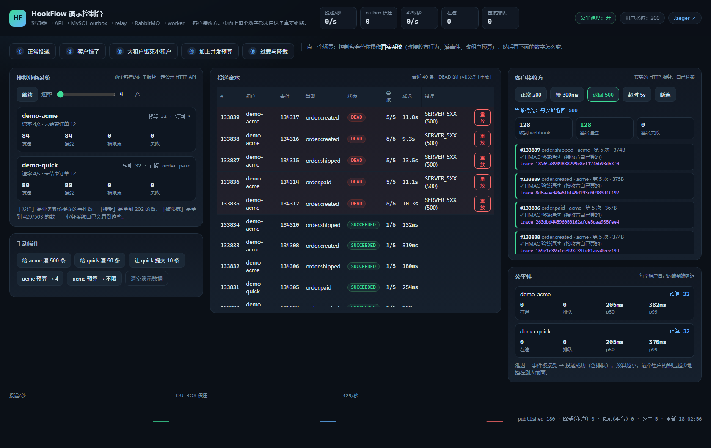

# 演示控制台：一个模拟业务系统 + 一块可以点的面板


打开 <http://localhost:8080/demo/>（也就是应用根路径 `/`）就能看到上面这一屏。

它不是动画，也不是 mock：左右两栏里每个数字都来自真实的 `delivery` / `event` / `outbox`
表，每条 webhook 都真的发到了 `127.0.0.1:9199` 上的一个小 HTTP 服务，那个服务自己用
HMAC 密钥验了签。

---

## 1. 它包含什么

| 部分 | 是什么 | 为什么这么做 |
|---|---|---|
| **模拟业务系统** | 两个客户的「订单服务」，每个都在跑 `order.created → order.paid → order.shipped` 的订单生命周期，通过**公开 HTTP API**（带真实 API Key）提交事件 | 如果直接调 `EventIngestService`，演示就跳过了认证、限流、背压、HTTP 序列化——恰好是过载时业务系统真正感觉到的东西 |
| **客户接收方** | 应用内一个真实的 HTTP 服务（`127.0.0.1:9199/hook/<租户>`），能自己验签，并且能被告知「返回 500 / 慢 5 秒 / 直接断连」 | 后三种行为就是三类故障：`SERVER_5XX`、`TIMEOUT`、`CONNECT_ERROR` |
| **控制台页面** | 一个静态页面（`/demo/`），每秒轮询 `/v1/demo/state` | 没有前端构建步骤：页面跟着 jar 一起发，`mvnw spring-boot:run` 起来就有 |

两个租户是刻意的：

| 租户 | 订阅 | 用途 |
|---|---|---|
| `demo-acme` | `*`（全部事件类型） | 被灌积压的那个 |
| `demo-quick` | 只有 `order.paid` | 被饿死的那个。它的事件少，所以受害者效应看得最清楚 |

---

## 2. 五个场景，各证明一件事

页面顶部的 ①–⑤ 按钮会替你调用控制台 API（改接收方行为、灌事件、改租户预算），
然后你只需要看数字。

### ① 正常投递

接收方返回 200，业务系统每秒 6 条。看「投递流水」：每个事件一次尝试就 `SUCCEEDED`，
「客户接收方」里**签名全部通过**——那个 ✓ 是接收方自己用密钥算出来的，不是平台告诉它的。

### ② 客户挂了

接收方改成返回 500。几秒内：

- 流水里出现 `RETRY_WAIT`，`尝试` 从 1/5 涨到 5/5，间隔按 `base × 2^n` 退避（演示 profile 是 0.8s 起）；
- 5 次用完 → `DEAD`，行变红，出现「重放」按钮；
- 接收方恢复后再点「重放」，**同一条 delivery** 用一次新尝试变成 `SUCCEEDED`（尝试次数不清零）。



「超时」和「断连」两种模式走的是同一套：分别归类成 `TIMEOUT` 和 `CONNECT_ERROR`，都重试。

### ③ 大租户饿死小租户（v0.2 的行为）

接收方变慢 300ms（一台扛不住的客户服务器），把 `acme` 的并发预算设成**不限**，灌 300 条，
同时让 `quick` 提交 10 条。

结果：`quick` 的事件排在 `acme` 的积压后面，p99 被拖到秒级。**积压没有变少，只是不再挡在别人前面**
——这正是 v0.3 之前的真实行为。

### ④ 加上并发预算

同一个场景，只把 `acme` 的预算改成 **4**：排队的永远只有 4 条，`quick` 的 p99 掉到百毫秒级，
而 `acme` 的积压总量一点没变。

这就是 [ADR-0009](adr/0009-fair-scheduling.md) 的机制在页面上的样子，和
[FairnessIT](v0.3-checklist.md) 里 4 584ms → 190ms 是同一个道理。

### ⑤ 过载与降载

把速率拉到 200/s（远超这台机器的容量），接收方 300ms。看：

- `429/秒` 开始跳，业务系统那两栏的「被限流」计数上涨——**业务系统自己看到的是 429，不是超时**；
- `outbox 积压` 顶在租户水位线（演示 profile 是 200）附近不再涨；
- p99 不会爆炸：平台在入口拒绝，而不是把所有人一起拖慢。

把速率拉回 5/s，积压十几秒内排空——降载是会**解除**的。

---

## 3. 怎么跑

```bash
docker compose up -d           # 本机 3306 被占用时：DB_PUBLISH_PORT=13306 docker compose up -d
./mvnw spring-boot:run          # 默认 profile = all，控制台自动打开
# → http://localhost:8080/    (会跳到 /demo/)
```

控制台只在 **`all` profile** 下存在。三角色部署（api / relay / worker）里 `/v1/demo/**` 是 404。

### 相关配置（`application-all.yml`，仅为演示而设）

| 配置 | 演示值 | 生产默认 | 为什么改 |
|---|---|---|---|
| `hookflow.demo.enabled` | true | false | 控制台本身 |
| `hookflow.demo.receiver-port` | 9199 | — | 假客户的端口 |
| `hookflow.demo.simulator-rate-per-second` | 4 | — | 开页时就有流量 |
| `hookflow.backpressure.tenant-high-watermark` | **200** | 10000 | 生产值点不到；200 才能真的看到 429 和积压排空 |
| `hookflow.delivery.read-timeout-ms` | **3000** | 10000 | 让「超时」模式 5 秒内可见 |
| `hookflow.retry.base-delay-ms` | **800** | 5000 | 让 `DEAD` 在十几秒内到达，退避阶梯本身不变 |

**这些都不是生产建议值。** 生产的水位线应该按「可接受等待 × 排空速率」定，见
[capacity.md](capacity.md)。

---

## 4. 安全模型：为什么它可以没有鉴权

`/v1/demo/**` **不需要 API Key**，这是刻意的：

- 页面在浏览器里，没有凭证；
- 把租户 API Key 放进 JavaScript 只是「看起来像安全边界」——打开开发者工具就能读到。

真正的边界是 **bean 不存在**：这几个控制器都是

```java
@Profile("all")
@ConditionalOnProperty(prefix = "hookflow.demo", name = "enabled", havingValue = "true")
```

所以在任何没同时满足「`all` profile + demo 开关」的进程里，这些路由是 404，而不是「有密码保护」。
`ApiKeyAuthFilter` 只是跳过了 `/v1/demo/` 的鉴权，它跳过一个不存在的接口没有意义。

演示假客户只监听 `127.0.0.1`，从不对外。

静态页本身（`/demo/index.html`）在任何 profile 下都能打开，因为它是普通静态资源；但它只能显示一句
「未启用」——它调用的 `/v1/demo/state` 在那边是 404。页面不缓存任何数据，所以也没有信息泄漏。

### 容器里也会起来

`Dockerfile` 的入口是 `java -jar`，默认 profile 是 `all`，所以 `docker compose --profile full up -d`
起来的那个容器**也会带控制台**（在容器内 `127.0.0.1:9199` 上起假客户，worker 在同一进程里，所以照常投递）。

这是给本地演示用的。**如果你把 8080 暴露到能被别人访问的地方，先关掉它：**

```bash
HOOKFLOW_DEMO_ENABLED=false docker compose --profile full up -d
```

验证方式：

```bash
curl -o /dev/null -w '%{http_code}\n' http://localhost:8080/v1/demo/state   # 期望 404
```

---

## 5. 它证明了什么（以及没证明什么）

| 页面上的东西 | 证据在哪 |
|---|---|
| 事件真的经过了 API、去重、outbox、relay、broker、worker | `DemoConsoleIT.simulatorProducesVerifiedDeliveries`：断言 DB 里 ≥2 条 `SUCCEEDED`，且接收方验签通过数 ≥2 |
| 5xx 会重试到死信，重放能救回来 | `DemoConsoleIT.brokenReceiverBecomesDeadAndReplayRecovers` |
| 预算按钮真的改了调度器的预算 | `DemoConsoleIT.budgetButtonChangesTheBudget`（改库 + `AdmissionControl.refresh()`） |
| 状态接口的每个字段都来自真实表 | `DemoConsoleIT.statePayloadIsComplete` |
| 两个租户各有一条真实 endpoint | `DemoConsoleIT.provisionsTwoTenantsWithEndpoints` |

**没证明**：

- 没有浏览器端自动化测试（没有 Playwright/Selenium）。页面的正确性是靠 `curl` / 截图 / 手工点验证的，
  接口契约由 `DemoConsoleIT` 覆盖。**这是缺口，不是「已经测过了」。**
- `demo-acme` / `demo-quick` 是固定名字，所以「清空演示数据」只清这两家的数据，不碰你自己的租户。

---

## 6. 控制台 API

| 方法 | 路径 | 作用 |
|---|---|---|
| `GET` | `/v1/demo/state` | 页面每秒钟拉一次的全部状态 |
| `POST` | `/v1/demo/simulator?running=&rate=` | 启停模拟业务系统 / 改速率（0–200/秒/租户） |
| `POST` | `/v1/demo/receiver?mode=&delayMillis=` | `OK` / `ERROR` / `SLOW` / `REJECT`，以及正常模式下的延迟（≤2s） |
| `POST` | `/v1/demo/burst?tenantId=&count=&perSecond=` | 灌事件（走真实 HTTP，不是直写库） |
| `POST` | `/v1/demo/tenants/{id}/budget?maxInFlight=` | 改租户并发预算，立刻生效 |
| `POST` | `/v1/demo/tenants/{id}/event` | 让某个租户的业务系统提交一条 |
| `POST` | `/v1/demo/deliveries/{id}/replay` | 重放死信 |
| `POST` | `/v1/demo/reset` | 停模拟、清空这两个租户的事件/投递/outbox |

`reset` 是**重试版**的：停止模拟不会停止已经在路上的请求，所以「删 attempts → 删 deliveries」
之间可能被插入一行，外键会拒绝——和 [failures/0007](failures/0007-cancel-vs-claim-deadlock.md)
是同一类问题，所以它按轮次重试直到表真的空了。
